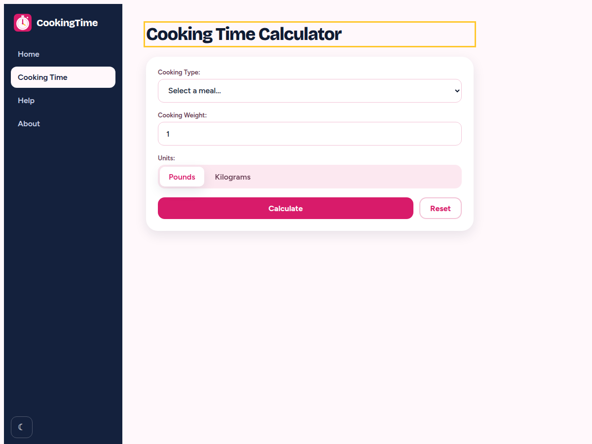

# Walkthrough

A hands-on tour of CookingTime in about 40 minutes. You build it, run the tests, use the app, follow
one request through the code, break things on purpose to watch the guards fail, and read the
decision trail. Each step says what to do, what you should see and why it matters.

> Every command and output below was run on 2026-11-20 against `main` at commit `8a1e892`, with
> .NET SDK 10.0.115 on Linux. Test counts and timings will drift; the shape should not.



## 0. What you need

- The **.NET 10 SDK**. `global.json` asks for 10.0.100 or a later feature band.
- **Git**. **Python 3** is optional, only for the coverage gate in step 6.
- A browser, for step 3.

## 1. Get it and build it (2 minutes)

```bash
git clone https://github.com/andreak3779/CookingTime.git
cd CookingTime
dotnet restore --locked-mode
dotnet build -c Release
```

**You should see:** `0 Warning(s)` and `0 Error(s)`.

**Why it matters:** `--locked-mode` makes the committed `packages.lock.json` files binding, so you
restore exactly what the author tested. The build also treats every warning as an error
(`TreatWarningsAsErrors`), so a clean build is a real one.

## 2. Run the tests (2 minutes)

```bash
dotnet test CookingTime.slnx -c Release --no-build
```

**You should see** three passing summaries, one per tier:

| Project | Tests | What it covers |
| --- | --- | --- |
| `CookingTime.UnitTests` | 199 | Domain, application, infrastructure and the guard tests |
| `CookingTime.ComponentTests` | 23 | Razor pages rendered with bUnit and real DI |
| `CookingTime.IntegrationTests` | 34 | `WebApplicationFactory`: routes, boot script, theme assets, CSP, feature flows |

**Why it matters:** the tiers answer different questions. Unit tests check the logic, component
tests check the pages, and integration tests check that the served app is wired together. Step 5
shows what the guard tests inside the unit tier protect.

## 3. Run it and use it (5 minutes)

```bash
dotnet run
```

Open **http://localhost:5000/cooking-time**. Try these in order:

1. **A normal calculation.** Choose *Pork Roast Loin, Leg, Butt*, enter **5**, keep **Pounds**, click
   **Calculate**. The result is a range that starts at **3 hrs. and 20 mins.** (5 lb at 40 minutes
   per pound is 200 minutes), with the roasting instructions underneath.
2. **Kilograms.** Enter **2.5** and choose **Kilograms**. The app converts at one point
   (`Weight.FromKilograms`, factor 2.20462262) and shows a time for about 5.5 lb.
3. **Bad input.** Click **Calculate** with no meal chosen. You get *Please select a meal.* as a
   validation message, not an error page.
4. **A weight the meal cannot take.** Choose the pork roast and enter **500** pounds. You get a
   message that the weight is *outside the supported range* (that meal allows 1 to 24 lb). In
   an earlier version this showed an inverted time range as if it had worked (Phase 14).
5. **Reset.** Click **Reset**. The form clears *and* the validation messages go away. That also
   used to be broken (Phase 17).
6. **Theme.** Click the moon button at the bottom of the sidebar to switch to dark mode. The button
   reports its state through `aria-pressed`.
7. **Other pages.** Visit **/help** and **/about**. Those are the only four routes.

Stop the server with Ctrl+C.

**Why it matters:** each of steps 3 to 5 is a failure mode that the codebase turns into a
`CookingResult` with errors instead of an exception. The UI renders one or the other.

## 4. Follow one request through the code (10 minutes)

Open these in order. The line numbers are for commit `8a1e892`.

| # | Where | What to notice |
| --- | --- | --- |
| 1 | [`Program.cs`](../Program.cs) | A handful of statements. It builds the host and calls `AddCookingTime`; nothing else is wired here |
| 2 | [`Application/ServiceCollectionExtensions.cs`](../Application/ServiceCollectionExtensions.cs) lines 43 to 73 | The single composition root. Options are bound and validated at startup (`ValidateOnStart`), and the factory and calculator are registered. The integration-test host calls the same method |
| 3 | [`Pages/CookingTime.razor`](../Pages/CookingTime.razor) line 99 | The page calls `Calculator.CalculateAsync(...)` through `ICookingTimeCalculator`, never a concrete class |
| 4 | [`Application/Services/CookingTimeCalculator.cs`](../Application/Services/CookingTimeCalculator.cs) lines 33 to 93 | Validate input, look up the meal by name (line 51), convert units (lines 66 and 67), ask the meal to calculate (line 79). Every failure is `CookingResult.Failure(...)`, and unknown meals and out-of-range weights are also logged |
| 5 | [`Domain/Meals/RangeMeal.cs`](../Domain/Meals/RangeMeal.cs) lines 44 to 60 | The meal owns its weight range and throws if it is violated. The comment explains the 500 lb bug this fixed |
| 6 | [`Domain/Strategies/`](../Domain/Strategies) | `RangeCookingStrategy` (minutes per pound) and `TableLookupStrategy` (ordered weight rows), both behind `ICookingStrategy` |
| 7 | [`Domain/ValueObjects/Weight.cs`](../Domain/ValueObjects/Weight.cs) line 30 | `FromKilograms`: the one conversion point. `Weight` is a `readonly record struct` |
| 8 | [`Infrastructure/Meals/MealFactory.cs`](../Infrastructure/Meals/MealFactory.cs) | Registers chicken and turkey in code and builds a `RangeMeal` for each entry in `wwwroot/appsettings.json` |

**Why it matters:** the same shape repeats. The UI knows only an interface, the application layer
turns errors into data, the domain protects its own invariants, and configuration is checked before
anything runs. The diagrams are in [architecture.md](architecture.md).

## 5. Break it on purpose (10 minutes)

Do this in a scratch copy, or undo each step afterwards with `git checkout -- .`. Each experiment
shows a guard doing its job.

### 5a. A bad catalog entry stops the app

Add this entry to the `Meals:Catalog` array in `wwwroot/appsettings.json`:

```json
{
  "Kind": "Range",
  "Name": "Test Roast",
  "Instructions": "x",
  "MinPounds": 1,
  "MaxPounds": 10,
  "MinMinutesPerPound": 50,
  "MaxMinutesPerPound": 40
}
```

```bash
dotnet test tests/CookingTime.IntegrationTests/CookingTime.IntegrationTests.csproj -c Release
```

**You should see** all 34 integration tests fail, each with the same message:

```text
OptionsValidationException : Meals:Catalog[10] ('Test Roast') has MaxMinutesPerPound (40) less than
MinMinutesPerPound (50); the range would be inverted.
```

**Why it matters:** the host cannot start with a bad catalog. The message names the entry that is
wrong, instead of an unhandled exception in the browser later (Phase 15).

### 5b. A floating package version is rejected

Change a package version in `CookingTime.csproj`, for example
`Microsoft.AspNetCore.Components.WebAssembly` from `10.0.15` to `10.*`, then:

```bash
dotnet test tests/CookingTime.UnitTests/CookingTime.UnitTests.csproj -c Release \
  --filter "FullyQualifiedName~BuildHardeningTests"
```

**You should see** 1 failure, `NoProject_UsesAFloatingPackageVersion`:

```text
Expected offenders to be empty because floating versions break reproducible builds - pin the exact
version and commit the regenerated packages.lock.json, but found at least one item
{"CookingTime.csproj: Version="10.*""}.
```

**Why it matters:** reproducibility is enforced by a test, not just promised in a doc (Phase 16).

### 5c. A second copy of the config is rejected

```bash
cp wwwroot/appsettings.json appsettings.json
dotnet test tests/CookingTime.UnitTests/CookingTime.UnitTests.csproj -c Release \
  --filter "FullyQualifiedName~ClientConfigurationDeliveryTests"
```

**You should see** 1 failure, `Appsettings_DoesNotAlsoExistAtTheRepositoryRoot`. Delete the copy again.

**Why it matters:** the Blazor WebAssembly SDK bundles only `wwwroot/appsettings*.json`. A config
file at the repo root looks right and is silently ignored, which once left the production meal
catalog empty (Phase 13). The test makes that mistake loud.

### 5d. Adding a meal is a config change, and a test pins the catalog

Add a *valid* entry to `wwwroot/appsettings.json`:

```json
{
  "Kind": "Range",
  "Name": "Lamb Roast - Medium",
  "Instructions": "Preheat oven to 325F. Roast until internal temperature reaches 145F.",
  "MinPounds": 2,
  "MaxPounds": 12,
  "MinMinutesPerPound": 25,
  "MaxMinutesPerPound": 30
}
```

Run `dotnet run` and the new meal is in the list with no code change (the open/closed idea). Then run
the integration tests:

**You should see** 1 failure, `MealCatalog_FromProductionConfig_IncludesEveryConfiguredMeal`:
*Expected meals to contain 12 item(s) because 2 code-baked meals (Chicken, Turkey) + 10 Range meals
configured in appsettings.json, but found 13.*

**Why it matters:** adding a meal is cheap, but the test pins the exact catalog, so a catalog change
is a deliberate edit to the test as well and cannot slip in by accident.

When you are done: `git checkout -- . && rm -f appsettings.json` (or just delete the scratch copy).

## 6. See the CI gate (3 minutes)

```bash
dotnet test tests/CookingTime.UnitTests/CookingTime.UnitTests.csproj -c Release \
  --settings coverlet.runsettings.xml
python3 scripts/check-coverage.py \
  "$(ls -t tests/CookingTime.UnitTests/TestResults/*/coverage.cobertura.xml | head -1)" \
  --threshold 75
```

**You should see:** `[PASS] GATE CookingTime.UnitTests 590/686 lines ( 86.01%)` and `PASS`.

Now raise the bar: change `--threshold 75` to `--threshold 90`.

**You should see:** `FAIL: coverage gate(s) not met`, `CookingTime.UnitTests: 86.01% < 90.00%`, and
exit status 1.

**Why it matters:** this is exactly what CI runs on every pull request to `main`
([`.github/workflows/ci.yml`](../.github/workflows/ci.yml)): locked restore, build with
warnings-as-errors, the three test projects, the coverage gate, a vulnerability audit of the
production project and a check that `dotnet publish` leaks no test assemblies.

## 7. Read the decision trail (10 minutes)

Pick one defect and follow it end to end. Phase 14 is a good one:

1. [README bug table, row 8](../README.md#bug-fixes-that-didnt-make-it-into-a-sprint-review): the
   symptom (a 500 lb roast shown as a success).
2. [`docs/phases/phase-14-domain-validation.md`](phases/phase-14-domain-validation.md): the
   reproduction, the fix and the numbers before and after.
3. The test that pins it: `Submit_ConfigDrivenMeal_OutOfRangeWeight_ReturnsValidationErrorAsync` in
   `tests/CookingTime.IntegrationTests/CookingTimeFeatureTests.cs`. It uses the **real** meal type
   through the real config rather than a mock, so it exercises the same path a visitor does.
4. [`docs/plan-codebase-review.md`](plan-codebase-review.md): the review that found it.

Then skim [`docs/decisions/`](decisions/README.md). [ADR 0009](decisions/0009-accepted-security-risks.md)
is the most telling: it records what was left out on purpose, with the condition that would reopen
each point. [HOW_THIS_WAS_BUILT.md](HOW_THIS_WAS_BUILT.md) has the table of defects that got
through green builds and how each was caught.

## What this walkthrough shows

- **A small product with real engineering around it:** layers, a tested domain, validation at the
  boundary, and results instead of exceptions.
- **Checks that fail loudly:** the experiments in step 5 each turn a quiet mistake into a failing
  test with a message that says what to do.
- **Work that is traceable:** every non-obvious choice has a phase doc or an ADR, and each defect
  links to the test that now prevents it.
- **Honest limits:** see [SCOPE-AND-LIMITS.md](SCOPE-AND-LIMITS.md). There is no hosting and no
  container yet, and the layering is a convention, not a compiler rule.
