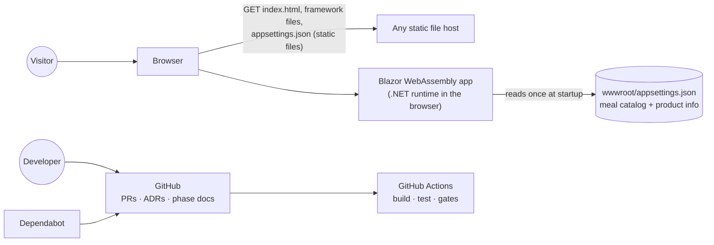
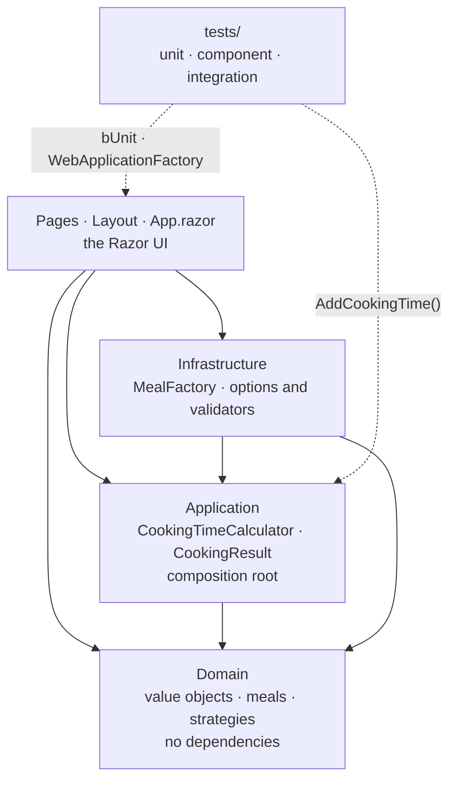
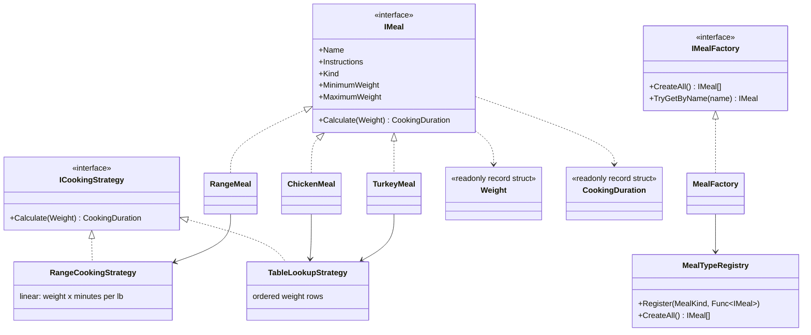
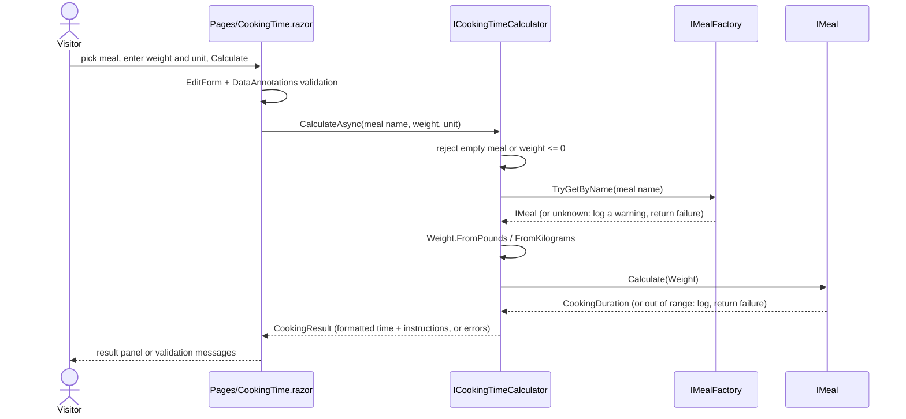
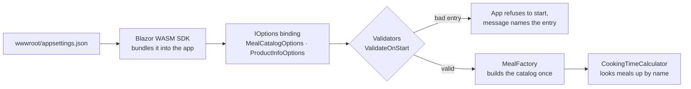
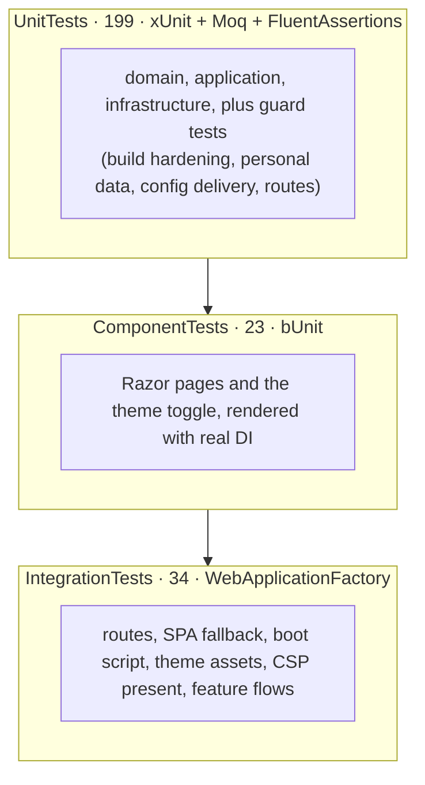
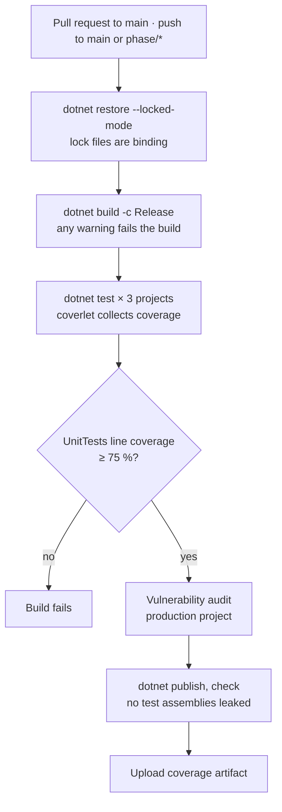

# CookingTime — architecture

A one-page cooking-time calculator built as a **Blazor WebAssembly** app on **.NET 10**. You pick a
meal, enter a weight in pounds or kilograms, and get a cooking-time range with instructions. It has
no server code, no database and no accounts: everything runs in the visitor's browser from
configuration that ships with the app.

The product is small on purpose. The engineering around it is the point: layered code, a tested
domain, security hardening, a locked build and a written trail of decisions. This page shows how the
pieces fit. The reasoning behind each decision is in [decisions/](decisions/README.md) and
[quality-attributes.md](quality-attributes.md); what the project does not do is in
[SCOPE-AND-LIMITS.md](SCOPE-AND-LIMITS.md); how it was built is in
[HOW_THIS_WAS_BUILT.md](HOW_THIS_WAS_BUILT.md).

## System context



After the page loads there are no network calls. There is no API to attack, no session to hijack and
no user data to leak. [ADR 0009](decisions/0009-accepted-security-risks.md) records what is absent
by design and the condition that would reopen each point.

## The layers

The code lives in one project (`CookingTime.csproj`), split into four folders that act as layers.
An arrow means "may use".



| Layer | Job | Notes |
| --- | --- | --- |
| `Domain/` | Meals, cooking strategies, `Weight` and `CookingDuration` | No dependencies. Value objects are `readonly record struct`, so they cannot be mutated by accident |
| `Application/` | `CookingTimeCalculator`, the `CookingResult` DTO, `AddCookingTime()` | The only thing the UI calls to calculate. Expected input problems come back as a result, never an exception |
| `Infrastructure/` | `MealFactory`, the options classes and their validators | Turns configuration into meals and refuses a bad catalog at startup |
| `Pages/`, `Layout/` | The Razor UI: calculator, help, about, theme toggle | Depends on `ICookingTimeCalculator`, not on a concrete class |
| `OriginalSource/` | The legacy WinForms code, kept as reference | Never referenced by new code |

The layering is a convention that review and the phase docs keep, not something a tool enforces
(see [SCOPE-AND-LIMITS.md](SCOPE-AND-LIMITS.md)).

## The domain



- **Strategy.** A meal delegates its arithmetic to an `ICookingStrategy`. Linear meals use
  `RangeCookingStrategy`; chicken and turkey use `TableLookupStrategy` over ordered weight rows.
- **Factory and registry (open/closed).** `MealTypeRegistry.Register(MealKind, Func<IMeal>)` adds a
  kind without editing a switch. `MealFactory` registers chicken and turkey itself and builds a
  `RangeMeal` for each catalog entry in configuration, so adding a range meal is a config change.
- **Value objects.** `Weight` has one conversion point (`FromKilograms`, factor `2.20462262`).
  `CookingDuration` rejects inverted bounds. The legacy mutable-value-object bug cannot be written
  again ([bug table in the README](../README.md#bug-fixes-that-didnt-make-it-into-a-sprint-review)).
- **Meals enforce their own range.** `RangeMeal.Calculate` rejects a weight outside its configured
  limits (Phase 14). Before that fix, a 500 lb roast produced an inverted range shown as a success.

## One request, end to end



`CookingResult` is a result-with-validation object: `IsSuccess` is true when there are no errors.
The UI renders one or the other and never catches an exception for a user mistake.

## Configuration and the trust boundary



`appsettings.json` is served to every visitor, so it is treated as public and untrusted:

- It lives under `wwwroot/` because that is the only place the WebAssembly SDK bundles it from. A
  guard test pins the location. (Phase 13 fixed a bug where the browser received no configuration at
  all and the catalog was empty.)
- Both options sections are validated at startup, with a message that names the offending entry.
- `ResumeUrl` is checked against an http/https allowlist.
- A guard test scans the served config for contact data and secret-shaped values.
- A Content-Security-Policy in `index.html` allows only same-origin scripts, styles, fonts and
  images. Script gets no inline allowance, and `'wasm-unsafe-eval'` is the one exception the .NET
  runtime needs to boot.

## Where files go

```text
CookingTime.csproj            the app: Blazor WebAssembly, net10.0, warnings are errors
Program.cs                    builds the host and calls AddCookingTime()
Domain/ Application/ Infrastructure/   the layers above
Pages/ Layout/ App.razor      the Razor UI
wwwroot/                      index.html (with the CSP), appsettings.json, css, js, self-hosted fonts, icons, help pages
tests/                        UnitTests · ComponentTests · IntegrationTests
OriginalSource/               legacy WinForms, reference only, personal data redacted (ADR 0010)
scripts/check-coverage.py     the coverage gate CI runs
docs/                         plan, phases, decisions (ADRs), onboarding, diagrams, this page
.github/                      CI workflow and dependabot config
```

`Program.cs` stays tiny on purpose (a handful of statements). The single composition root,
`Application/ServiceCollectionExtensions.AddCookingTime`, is called by both the browser app and the
integration-test host, so test wiring cannot drift from production wiring.

## How it is tested



Counts are from the 2026-11-20 run; run `dotnet test` for the current numbers. Only the unit tests
drive the coverage gate (the other two tiers measure a lot of generated and framework code, so
their percentages are informational).

Beyond behaviour, a set of **guard tests** pins properties that are easy to break quietly: no
floating package version, a lock file for every project, CI pinned to commit SHAs, no test
assembly in the publish output, `appsettings.json` only under `wwwroot/`, exactly one component per
route, and no personal data in any tracked file.

## CI and the build gate



Supply chain: exact package versions, committed `packages.lock.json`, `NuGet.config` with source
mapping, `global.json` pinning the SDK, every GitHub Action pinned to a commit SHA, and Dependabot
(grouped minor and patch updates, major versions left for a deliberate decision).

## Running it

```bash
dotnet restore --locked-mode
dotnet build -c Release                       # 0 warnings, 0 errors
dotnet test --settings coverlet.runsettings.xml
dotnet run                                    # serves the Blazor app locally
```

More diagrams (domain, branches and tags, the AI-assisted workflow) are in
[DIAGRAMS.md](DIAGRAMS.md). A guided code tour is in [onboarding.md](onboarding.md).
